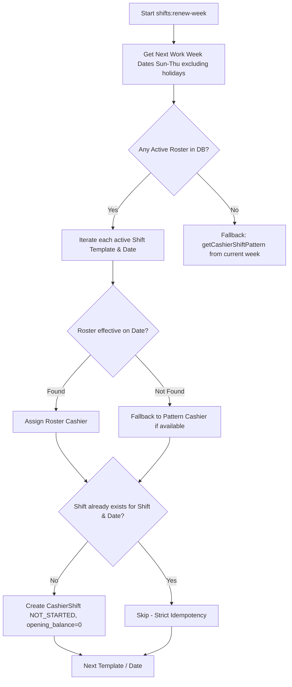

# ASSAB ERP — P4b Design Document: Durable Recurring Roster Assignment by Effective Date

**Task:** Shift Meeting Remediation — Gate G5 (P4b / MT-23 / F03)  
**Author:** Antigravity (Principal Engineer)  
**Date:** 2026-11-12  
**Target Authority:** Mahmoud — Final Acceptance Authority  
**Independent Reviewer:** ChatGPT Work  
**Status:** `IMPLEMENTED (LOCAL) — MIGRATION NOT EXECUTED — SCHEDULER NOT VERIFIED`

---

## 1. Problem Statement & Audit Finding (F03)

In the legacy implementation of `ShiftWeekRenewalCommand`, renewal of the work week was computed via `getCashierShiftPattern($currentStart, $currentEnd)` querying:
```sql
SELECT DISTINCT cashier_id, shift_id FROM cashier_shifts WHERE shift_date BETWEEN ? AND ?
```
This exhibited critical operational flaws:
1. **Substitute Cashier Revival:** If a substitute or temporary cashier covered a shift on Tuesday, renewing next week revived that substitute for the entire upcoming week.
2. **Ambiguous Assignment:** If multiple cashiers worked the same template during the week (e.g. midweek reassignment), both cashiers were extracted, leading to conflicting/duplicate shifts.
3. **Lack of Effective Dating:** Branch managers and accountants had no mechanism to schedule a recurring cashier assignment starting on a specific future date or expiring on an explicit boundary date.

---

## 2. Architecture & Database Design

### 2.1 Table: `branch_shift_roster_assignments`

An additive, non-destructive table is introduced via migration `2026_11_12_000001_create_branch_shift_roster_assignments_table.php`:

| Column | Type | Nullable | Description |
|---|---|---|---|
| `id` | `uuid` | NO | Primary UUID key |
| `branch_id` | `foreignUuid` | NO | Constrained to `branches.id`, cascade delete |
| `shift_id` | `foreignUuid` | NO | Constrained to `shifts.id` (Template), cascade delete |
| `cashier_id` | `foreignUuid` | NO | Constrained to `cashiers.id`, cascade delete |
| `effective_from` | `date` | NO | Start date of recurring assignment (inclusive) |
| `effective_to` | `date` | YES | End date of recurring assignment (inclusive; null = open-ended) |
| `created_by` | `uuid` | YES | User ID of creator (Manager/Accountant) |
| `created_at`, `updated_at` | `timestamp` | YES | Audit timestamps |

**Indexes:**
- `roster_branch_shift_effective_idx` on `(branch_id, shift_id, effective_from)`
- `roster_cashier_effective_idx` on `(cashier_id, effective_from)`

### 2.2 Eloquent Model: `BranchShiftRosterAssignment`

Namespace: `Modules\Shift\Models\BranchShiftRosterAssignment`

Scope: `scopeActiveForDate($query, $date)`:
```php
$query->whereDate('effective_from', '<=', $date)
      ->where(function ($q) use ($date) {
          $q->whereNull('effective_to')
            ->orWhereDate('effective_to', '>=', $date);
      });
```

---

## 3. Renewal Command Engine (`ShiftWeekRenewalCommand`)

The renewal engine follows a strict priority hierarchy:



### 3.1 Strict Idempotency (Running Twice)
Duplicate prevention is enforced at the template-date level:
```php
$exists = CashierShift::where('shift_id', $shift->id)
    ->whereDate('shift_date', $dateStr)
    ->exists();
```
Running the command a second, third, or Nth time creates **0 new shifts**, preserving existing shift UUIDs, timestamps, and cashier assignments.

### 3.2 Midweek Effective Date Boundaries
When a cashier transition occurs midweek (e.g. Cashier A ends Tuesday `effective_to = 2026-11-17`, Cashier B starts Wednesday `effective_from = 2026-11-18`):
- Sunday, Monday, Tuesday evaluate Cashier A as active.
- Wednesday, Thursday evaluate Cashier B as active.
- Previous days' historical shifts are completely preserved without overwrite.

### 3.3 Deactivated Template Protection
Templates with `is_active = false` are filtered out (`Shift::where('is_active', true)`). Even if a historical roster record references an inactive template, no shifts are created.

### 3.4 Fallback Behavior
If no rows exist in `branch_shift_roster_assignments`, the engine gracefully reverts to `getCashierShiftPattern($currentStart, $currentEnd)`. All legacy workflows remain operational.

---

## 4. Governance & Deployment Boundaries

- **Local Verification:** Executed exclusively on SQLite in-memory test databases within `wt_shiftmtg_backend`.
- **Migration Execution:** `NOT EXECUTED` on production or staging MySQL databases.
- **Scheduler Verification:** Cron/Scheduler registration is documented but not triggered on remote environments.
- **Delivery Status:** `IMPLEMENTED (LOCAL) — MIGRATION NOT EXECUTED — SCHEDULER NOT VERIFIED` per Section 9 of Project Governance.
