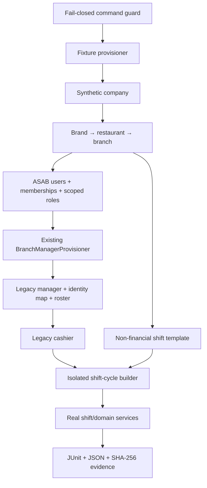

# ASSAB ERP automated test harness

## Status and immutable inputs

This harness is development/test tooling. It does not establish deployment,
health, test acceptance, or business acceptance for Staging.

| Item | Verified value | Meaning |
|---|---|---|
| Accepted integration baseline | `57bd40c3d55393db2cc113328e221d5d3a85caa0` | Accepted lower bound; unchanged at investigation time |
| Previously reviewed shift candidate | `bc0b87c39d8659a571dbfb44d1c1d651a314bf16` | Historical reviewed SHA, not the branch's current HEAD |
| Current candidate branch HEAD | `dabae358560bacf00137ed5c21d31320669363f6` | Remote HEAD reverified and selected as the immutable development input |
| Task branch | `task/brc34-automated-staging-test-harness-dabae358-20261017` | Must not be merged or deployed by the harness |
| Business authority | `Assab Business Rules v3.4 — 2026-10-13` | 69 authoritative acceptance scenarios |

Both remote branch heads were re-read from the original GitHub repository on
2026-10-17. The 69 registry rows were also compared field-for-field with the
v3.4 authority: IDs, preconditions, expected results, and rule references match
69/69 with no additions. The older 2026-10-11 project handoff remains useful
history, but its v3.1 authority and old branch heads are superseded here.

`dabae358` descends from `3c85fd9`, `57bd40c`, and `bc0b87c`. Its intervening
commits contain the reviewed BRC v3.4 F-01/F-03/F-04/F-05/F-06 corrections and
post-correction evidence. The harness integration leaves those financial
implementation paths unchanged. The candidate remains **unaccepted** until its
own gates and independent review complete.

## Read-only architecture findings

The investigation covered migrations and indexes, Eloquent models, auth and
token services, tenant/role middleware, onboarding/provisioning services,
factories, shift services/tests, and existing GitHub Actions.

- `/api/v1/company/onboard` is not a first-user bootstrap. It is behind
  `auth:sanctum`, `asab.tenant`, and `asab.role:company-admin`.
- Platform company creation also requires an authenticated `admin`. The only
  pre-existing from-empty path is the broad demo seeder; it creates unrelated
  demo data and known credentials and is not safe as a staging bootstrap.
- Therefore the repository had no approved minimal first-principal mechanism.
  `asab:harness:provision-staging` fills only that fixture need and is guarded
  independently of normal onboarding.
- Dashboard identities are `AsabUser` records with `AsabUserRole` assignments.
  Company membership is a separate `asab_company_users` row with a unique
  `(company_id, user_id)` index.
- Cashier authentication is a separate legacy `Cashier` authenticatable and
  `/api/v1/cashier/auth/login`; a cashier is not fabricated as an ASAB role.
- A branch dashboard user is dual-provisioned through the existing
  `BranchManagerProvisioner`, which creates/updates the legacy manager, identity
  map, and roster dependency inside the fixture transaction.
- Passwords use the models' `hashed` casts. The command accepts only a runtime
  secret source and never places a password or token in its manifest/output.
  Existing branch-manager/cashier update logs now redact password and remember-
  token fields so credential hashes are not emitted during idempotent reruns or
  password rotation.
- `EnsureAsabRole` evaluates the union of all role assignments. By contrast,
  `ResolveTenant` calls `roleAssignments->first()` without a defined ordering
  and derives its active scope from only that row. No role-switch endpoint
  exists. Multi-role authorization is supported, but deterministic active-role
  switching is **not supported**; this is a documented product limitation, not
  something the harness hides.
- Compatibility-mode auth issues familyless access/refresh tokens. Session
  family mode issues scoped `admin:access`/`admin:refresh` tokens, rotates the
  pair, and revokes the family. The harness exercises the latter as well as
  cashier Sanctum authentication.
- Source inspection exposed a cross-authenticatable boundary defect: a legacy
  cashier bearer could reach the Admin `auth/me` controller, which is typed for
  `AsabUser`. `EnsureAdminAccessToken` now rejects any non-`AsabUser` tokenable
  with a 401 before controller dispatch; the harness contains the regression
  assertion. This is an authentication fix, not a financial-rule change.
- Authoritative shift behavior lives in services such as
  `CashierShiftStartService`, `HandoverService`, `ShiftCashCountService`, report
  revision/correction/review services, and liability/settlement services. The
  harness reuses those paths and does not change financial formulas or rules.

### Relevant schema invariants

| Relation | Important constraint/default |
|---|---|
| `asab_users` | UUID PK; globally unique email; nullable indexed company; hashed model cast |
| `asab_roles` | Unique canonical role key |
| `asab_user_roles` | Indexed user; scope defaults to `all` in schema, so the harness always writes an explicit narrower scope |
| `asab_company_users` | Unique company/user membership |
| `branch_managers` | Unique email and phone; real FK to branch |
| `cashiers` | Unique email; real FKs to branch and creating manager |
| `shifts` | Unique `(branch_id, start_time, end_time)` |
| `cashier_shifts` | Unique `(cashier_id, shift_id, shift_date)` plus financial and lifecycle fields |
| shift evidence tables | Revision/receipt/allocation/idempotency unique keys and restrictive/cascading FKs vary by aggregate |

No schema migration or staging seeder is added by this harness.

## Fixture dependency graph



The controlled staging command stops at the non-financial template. Cashier
shift assignments, sales, custody movements, handovers, corrections, and
approvals are generated only in Mode A disposable databases.

## Test-account and role matrix

Every email is derived from the chosen namespace and ends in
`@fixture.invalid`. One runtime password is supplied through an environment
variable and is never written to Git or evidence.

| Fixture | Authenticatable / login | ASAB roles | Explicit scope | Authorized probe | Forbidden probe / note |
|---|---|---|---|---|---|
| Company Admin | `AsabUser`, `/api/v1/auth/login` | `company-admin` | one brand/restaurant/branch | `/api/v1/company/me/brands` | Branch/accountant/head-only routes |
| Branch Manager | `AsabUser` plus provisioned legacy manager | `branch` | one branch | `/api/v1/company/me/branch/overview` | Accountant dashboard |
| Accountant | `AsabUser` | `accountant` | one restaurant and branch | `/api/v1/company/me/accountant/dashboard` | Head dashboard |
| Head Accountant | `AsabUser` | `head` | one brand/restaurant/branch | `/api/v1/company/me/head/dashboard` | Company-admin mutation surface |
| Multi-role Finance | `AsabUser` | `accountant`, `head` | both assignments cover the same fixture hierarchy | Accountant and head routes | `/auth/switch-role` is absent; first-assignment tenant scope is a known risk |
| Restricted User | `AsabUser` | none | no role assignment | Login and `/api/v1/auth/me` | Every role-gated route returns 403 |
| Cashier | legacy `Cashier`, `/api/v1/cashier/auth/login` | not an ASAB role | fixture branch via FK | `/api/v1/cashier/profile` | Dashboard `/api/v1/auth/me` rejects the wrong authenticatable |

### Canonical permission defaults inspected

| Role | General matrix default | Notable override | Route authority |
|---|---|---|---|
| `company-admin` | `view` | `final` for user/subscription management; no permissions-matrix authority | `asab.role:company-admin` |
| `branch` | `submit` | management/ERP/permissions are `none` | `asab.role:branch` |
| `accountant` | `approve` | management/ERP/permissions are `none` | `asab.role:accountant` |
| `head` | `final` | ERP export remains `final`; management/permissions are `none` | `asab.role:head` |
| Cashier | n/a | legacy guard and branch relationship | `cashier` middleware |
| Restricted | none | no role assignment | denied by every `asab.role:*` gate |

The staging fixture does not create or widen permission-matrix rows. It uses
existing canonical role definitions and existing matrix entries, reports any
role with no platform default, and grants no `scope=all` assignment.

## Mode A — isolated automated tests

Mode A is the only mode that runs tests. It uses synthetic fixtures and refuses
all staging/production targets.

### SQLite in-memory

Prerequisites: PHP 8.3 with required extensions and `composer install` from the
locked dependency file.

```bash
bash scripts/harness/run_sqlite.sh artifacts/assab-harness-sqlite
```

The runner applies the existing three-layer SQLite isolation guard, runs the
BRC v3.4 FAST suite, and adds every test changed since pre-correction SHA
`3c85fd9`. This deliberately reruns both the Candidate's financial-correction
tests and the harness tests against the integrated `dabae358` lineage, then
emits:

- `harness.junit.xml` and console log;
- `business-rules-evidence.json` with all 69 scenario records;
- `business-rules-evidence.junit.xml` with one test case per AC plus the harness
  execution status;
- `business-rules-evidence.md` and `SHA256SUMS.txt`.

The JSON/Markdown also record aggregate JUnit counts and every runner exit
code, so an unmapped harness/setup failure cannot be hidden by a green AC map.

### MySQL 8.4 disposable service

The MySQL runner requires an explicit opt-in, exact TCP loopback
`127.0.0.1:3306`, exact generated
schema prefixes, numeric run IDs, and a server reporting `8.4.x`. It creates
new per-suite schemas only. Before every `migrate:fresh`, a read-only booted
Laravel guard verifies that DSN/socket overrides are empty and that the live
PDO target is the exact disposable schema on loopback MySQL 8.4/InnoDB. It is
never aimed at `assab_staging`.

```bash
export ASSAB_HARNESS_MYSQL_OPT_IN=1
export ASSAB_HARNESS_RUN_ID=1001
export ASSAB_HARNESS_RUN_ATTEMPT=1
export DB_HOST=127.0.0.1 DB_PORT=3306 DB_USERNAME=root
# Inject DB_PASSWORD through the runner/secret facility; do not type or echo it.
bash scripts/harness/run_mysql84.sh artifacts/assab-harness-mysql84
```

GitHub Actions uses an ephemeral MySQL 8.4 service with no stored credential.
The MySQL job is skipped on push and pull request; it can run only from an
explicitly authorised `workflow_dispatch` with `run_mysql84=true`. The job runs
the harness/API/idempotency tests and independent-process shift, report-review,
and auth concurrency suites. Existing MariaDB-named gates were made
engine-neutral only at their version assertion; their financial behavior was
not altered.

## Mode B — controlled staging demo data

The command's default mode is a read-only plan. Even the plan refuses anything
other than exact `APP_ENV=staging`, MySQL, and an exact allowlisted database.

Required configuration (names only; no value is committed for the credential):

```text
ASSAB_STAGING_HARNESS_ENABLED=false
ASSAB_STAGING_HARNESS_DATABASE_ALLOWLIST=assab_staging
ASSAB_STAGING_HARNESS_NAMESPACE=assab-harness-v1
ASSAB_STAGING_HARNESS_PASSWORD_ENV=ASSAB_HARNESS_PASSWORD
```

Read-only plan:

```bash
php artisan asab:harness:provision-staging \
  --namespace=assab-harness-v1 --json
```

Mutation command, to be used **only after a separate explicit staging-write
approval** and after the password variable has been injected securely into the
process environment:

```bash
php artisan asab:harness:provision-staging \
  --namespace=assab-harness-v1 \
  --apply \
  --ack=PROVISION_ASSAB_STAGING_HARNESS \
  --password-env=ASSAB_HARNESS_PASSWORD \
  --json
```

All mutation gates are required simultaneously. The command:

- acquires a per-namespace MySQL advisory lock;
- verifies that the configured and live database names are identical and
  allowlisted, and that the live staging server reports MySQL 8.4.x;
- uses deterministic UUIDs/emails (including the legacy manager) and a stable definition hash;
- locks and updates only rows proven to belong to the fixture namespace;
- fails on ambiguous IDs, emails, schedules, duplicate assignments, or missing
  canonical role definitions;
- hashes the runtime password and revokes only fixture-owned tokens on rerun;
- uses the real branch-manager dual-provisioner;
- creates no permission grants, cashier shifts, sales, custody entries,
  handovers, liabilities, or other financial transactions;
- writes a secret-free manifest to the configured local storage disk;
- reports `APPLIED_WITH_EVIDENCE_ERROR` (including the secret-free manifest in
  JSON mode) if rows commit but manifest persistence fails, so an applied run
  is never mislabeled as a pre-write refusal;
- never runs migrations, seeders, resets, cleanup, deployment, or restart.

### Cleanup proposal — intentionally not implemented or executed

Cleanup requires a separate change/approval. A safe cleanup operation should:

1. Load the exact stored manifest and verify its definition SHA.
2. Re-run the environment/database/namespace guards.
3. Perform a read-only dependency census and refuse any non-fixture descendant
   or any financial/operational record.
4. Require a different explicit acknowledgement phrase.
5. Delete only manifest IDs in reverse dependency order and record a signed
   evidence manifest.

There is no automatic reset and no cleanup command in this change.

## Business Rules v3.4 evidence model

`docs/testing/brc34_acceptance_registry.json` records every AC-01…AC-69 with:

- Business Rule references;
- preconditions;
- fixture dependencies;
- acting role(s);
- API/service operation category;
- expected result;
- database invariants.

`scripts/harness/summarize_evidence.py` combines that authority metadata, the
reviewed coverage matrix, and current JUnit. It records current actual results
and evidence references. A scenario becomes `PASS` only when every mapped test
appears and passes in the supplied current-run JUnit. It never converts prior
prose into current evidence.

The post-correction Candidate matrix currently maps:

| Reviewed classification | Count | Meaning |
|---|---:|---|
| Covered — prior executed pass | 34 | Has mapped evidence in the post-correction matrix; must run again for current PASS |
| Partially covered | 25 | Some rule behavior or boundary remains unproven |
| Not implemented — blocked | 9 | Requires schema or a business decision; prior classification is not current execution evidence |
| Gap — test missing | 1 | No adequate executable acceptance test |

The superseded 5 `LEGACY CONFLICT` / 64 `NOT_RUN` result from the older
`3c85fd9`-based harness is not reused as evidence for this Candidate.

The harness does not claim all 69 scenarios pass and does not modify business
rules to make a test green.

## Independent audit checklist

- [ ] Verify the tested SHA and both ancestor relationships independently.
- [ ] Confirm the workflow contains no staging/Coolify endpoint, repository
      secret reference, deploy step, or mutable third-party action tag.
- [ ] Confirm PHP reports 8.3.x and the integration service reports MySQL 8.4.x.
- [ ] Confirm every MySQL schema name matches the disposable allowlist regex.
- [ ] Inspect JUnit, JSON summary, logs, and `SHA256SUMS.txt`; do not infer PASS
      from a committed test.
- [ ] Reconcile all 69 AC records and investigate every FAIL/BLOCKED/PARTIAL/NOT_RUN.
- [ ] Distinguish fixture/setup failures from product-rule failures before any fix.
- [ ] Confirm no migration, seeder, dependency manifest, deployment file, or
      financial rule changed unexpectedly.
- [ ] Confirm staging remains untouched unless a separate approval identifies
      the exact command, namespace, database, and operator.
- [ ] Preserve the state chain independently:
      `COMMITTED → INTEGRATED → DEPLOYED → HEALTHY → TESTED → ACCEPTED`.

## Current authorization boundary

Creating this branch and its local commit does not authorize push, PR, merge,
deployment, Coolify changes, or staging database writes. Those are separate
release actions and must be approved and evidenced separately.
